<!-- Gerado por scripts/terminal.py e atualizado diariamente por .github/workflows/terminal.yml. Edite o script, não este arquivo. -->

<picture>
  <source media="(prefers-color-scheme: dark)" srcset="https://github.com/cjdotcom/cjdotcom/raw/main/assets/terminal-dark.svg">
  <source media="(prefers-color-scheme: light)" srcset="https://github.com/cjdotcom/cjdotcom/raw/main/assets/terminal-light.svg">
  
</picture>

<picture>
  <source media="(prefers-color-scheme: dark)" srcset="https://raw.githubusercontent.com/cjdotcom/cjdotcom/output/github-contribution-grid-snake-dark.svg">
  <source media="(prefers-color-scheme: light)" srcset="https://raw.githubusercontent.com/cjdotcom/cjdotcom/output/github-contribution-grid-snake.svg">
  
</picture>

